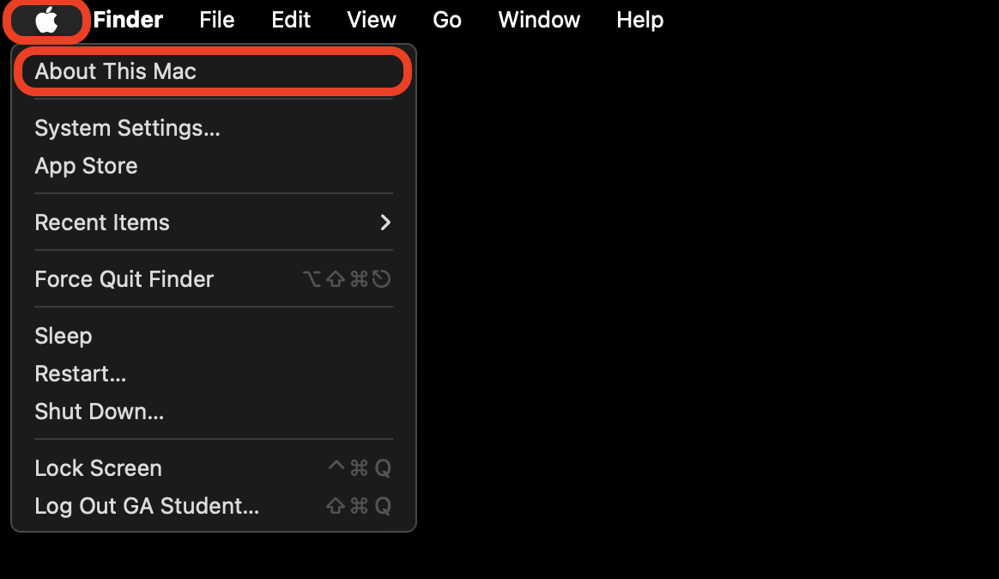
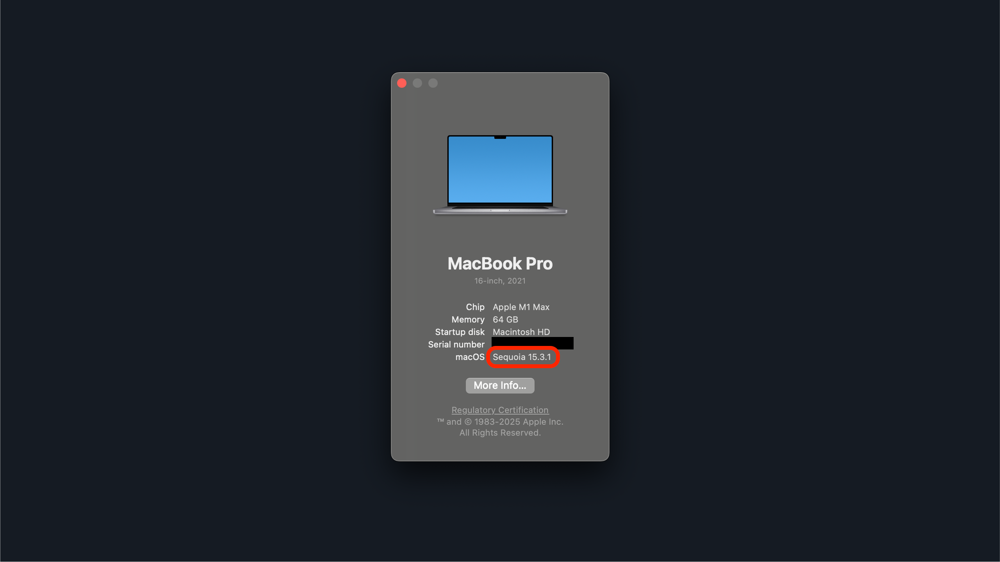
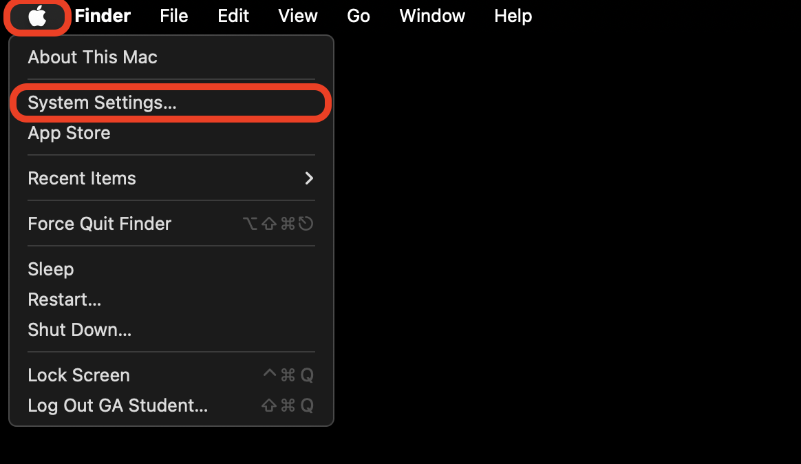
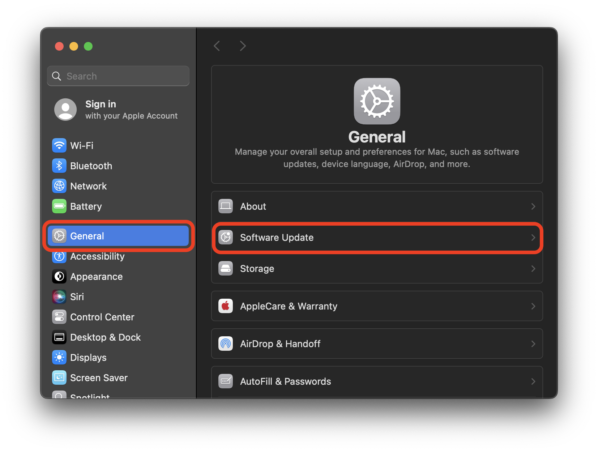
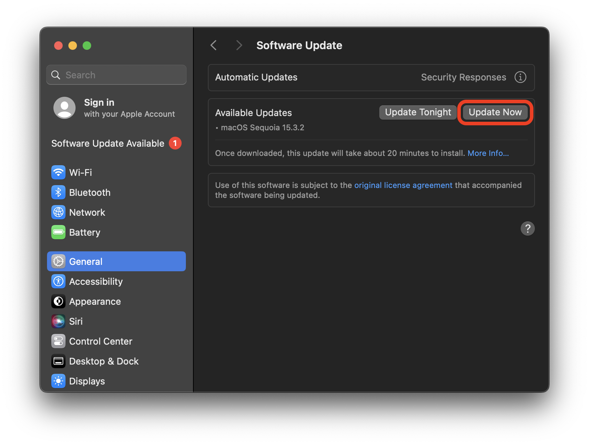
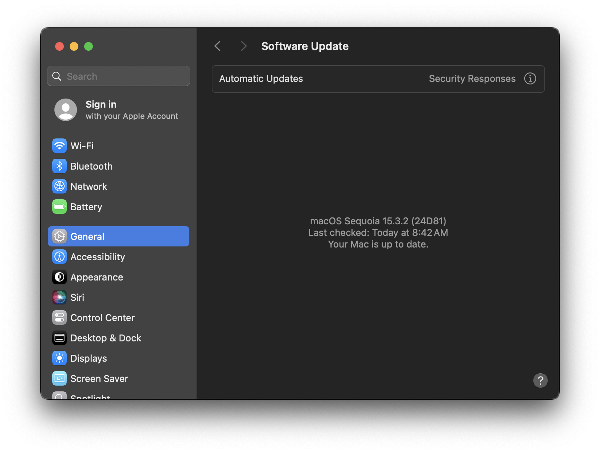

<h1>
  Update Your Computer Lab
  Update Your Computer - macOS
</h1>

**Learning objective:** By the end of this lesson, students will be able to check their macOS version, determine if updates are available, and apply those updates to their system.

## Checking your OS version and update status

Identify your current OS version and check for available updates.

1. Select the **Apple** menu in the top left of the screen and select and then **About This Mac**.

   

2. A window will appear displaying information about your Mac, find the **macOS** information.

   

### Reflection

What is your current OS version? Note these in the **OS version at the start of the lab** section of your lab's <code class="filepath">README.md</code> file.

## Applying the latest updates to your OS

Your device will restart as part of the update process. Make sure to save any work you want to keep before proceeding. After completing the update you will need to reopen this lab.

Perform an OS update following the standard procedures.

1. Select the **Apple** menu in the top left of the screen and select **System Settings...**.

   

2. In the **System Settings** menu, select **General** in the left sidebar and then select **Software Update**.

   

3. When you arrive in the Software Update menu you may see a couple of different options:

   **a.** You may have updates that are ready to install already. If so, select the **Update now** button, complete the update process, and skip to the next section.

   

   **b.** If no updates are available, you will see a message that says **Your Mac is up to date**. If so, continue to the next section.

   

### Reflection

Were there any updates available for your system? Were you able to install them? Note the answer to these questions in the **Were you able to install any updates for your system?** section of your lab's <code class="filepath">README.md</code> file.

## Verifying the update

Confirm that the update was successful and explore any new features or changes. After your computer restarts, return to the **About This Mac** panel to confirm your Mac updated.

### Reflection

What is your current OS version? Note this in the **OS version at the end of the lab** section of your lab's <code class="filepath">README.md</code> file.

Finally, note how long it took to complete the update process and if you encountered any issues during the update process in the **Wrap up** section of your lab's <code class="filepath">README.md</code> file.

Don't forget to add, commit, and push your changes to GitHub and submit the lab.
