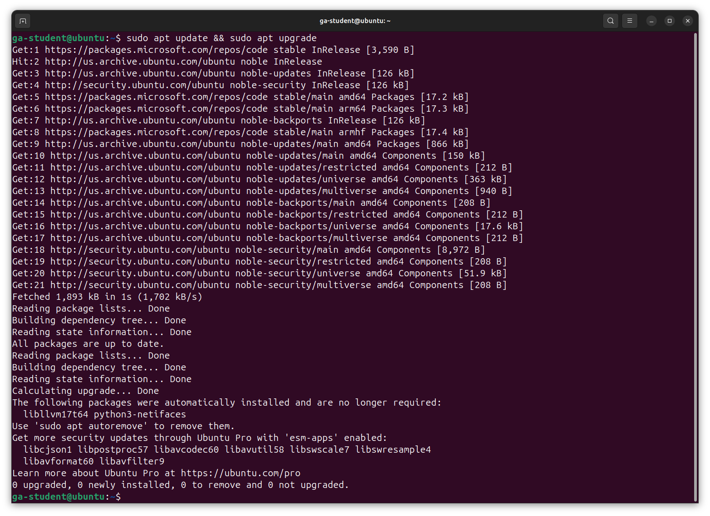

<h1>
  <span class="headline">Update Your Computer Lab</span>
  <span class="subhead">Update Your Computer - Ubuntu</span>
</h1>

**Learning objective:** By the end of this lesson, students will be able to check their Ubuntu OS version, determine if updates are available, and apply those updates to their system.

## Checking your OS version and update status

Identify your current OS version and check for available updates.

1. Open the **Terminal** application.

2. Run the `lsb_release -d` command to see the current OS version.

### Reflection

What is your current OS version? Note these in the **OS version at the start of the lab** section of your lab's <code class="filepath">README.md</code> file.

## Applying the latest updates to your OS

Perform an OS update following the standard procedures.

1. Run the following command to update the package list and upgrade the installed packages:

   ```bash
   sudo apt upgrade && sudo apt update
   ```

2. You'll be prompted for your user password and to accept the changes that will be made. Do so. Any available updates will be downloaded and installed.

   

### Reflection

Were there any updates available for your system? Were you able to install them? Note the answer to these questions in the **Were you able to install any updates for your system?** section of your lab's <code class="filepath">README.md</code> file.

## Verifying the update

Run the `lsb_release -d` command again to see the current OS version.

### Reflection

What is your current OS version? Note this in the **OS version at the end of the lab** section of your lab's <code class="filepath">README.md</code> file.

Finally, note how long it took to complete the update process and if you encountered any issues during the update process in the **Wrap up** section of your lab's <code class="filepath">README.md</code> file.

Don't forget to add, commit, and push your changes to GitHub and submit the lab.
