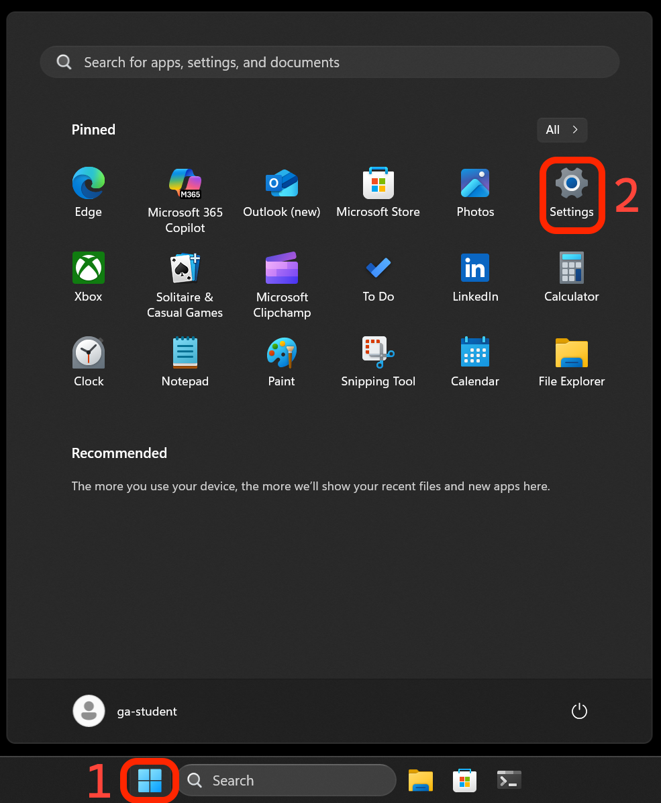
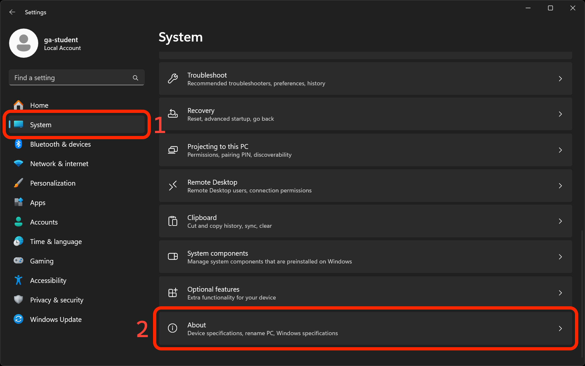
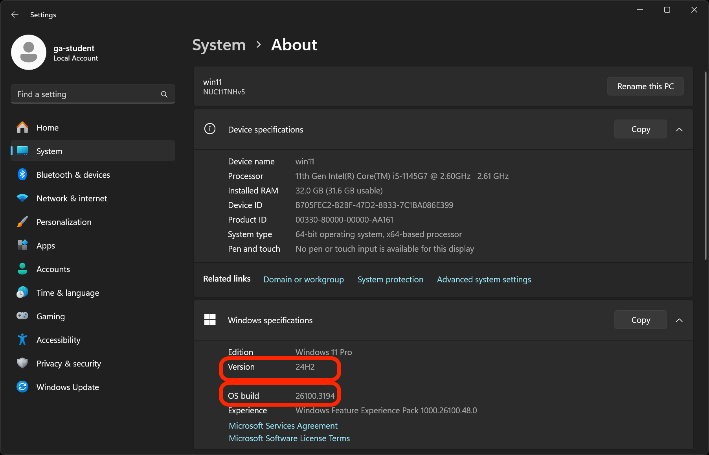
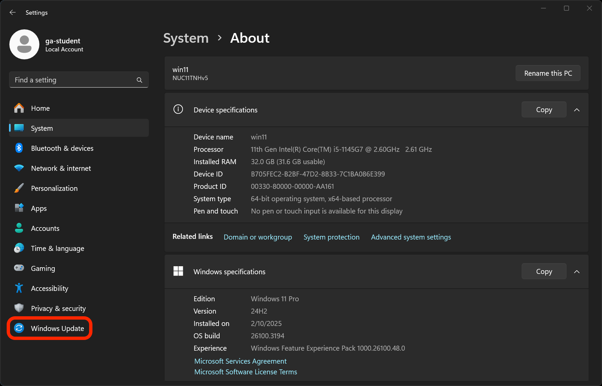
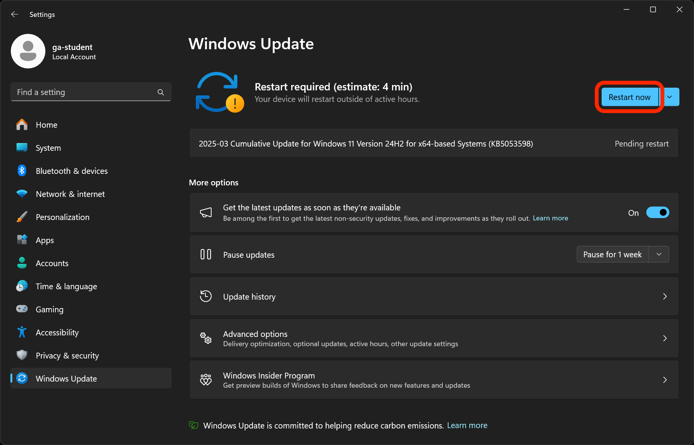
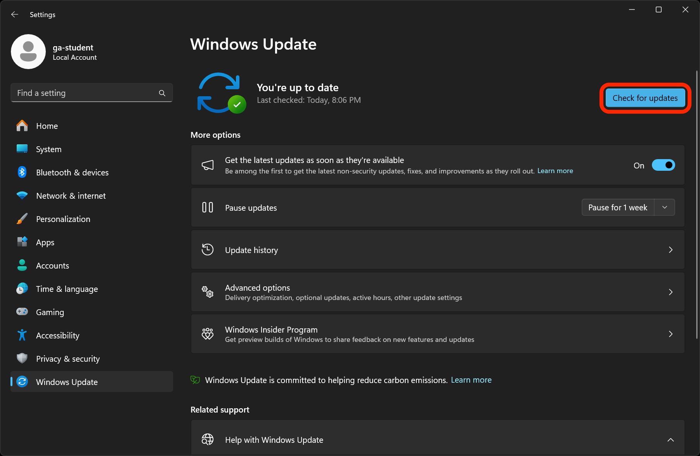
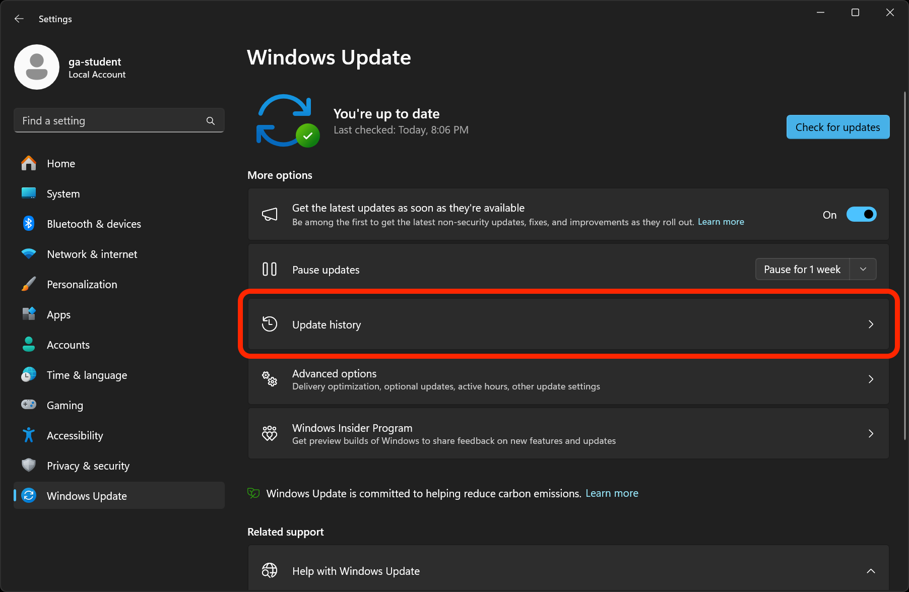

<h1>
  Update Your Computer Lab
  Update Your Computer - Windows
</h1>

**Learning objective:** By the end of this lesson, students will be able to check their Windows OS version, determine if updates are available, and apply those updates to their system.

## Checking your OS version and update status

Identify your current OS version and check for available updates.

1. Select the Start menu and then **Settings**.

   

2. Select on **System** and scroll to the bottom and select **About**.

   

3. Under **Windows specifications**, find the **Version** and **OS build** information.

   

### Reflection

What is your current OS version? What is the OS build number? Note these in the **OS version at the start of the lab** section of your lab's <code class="filepath">README.md</code> file.

## Applying the latest updates to your OS

Your device will restart as part of the update process. Make sure to save any work you want to keep before proceeding. After completing the update you will need to reopen this lab.

Perform an OS update following the standard procedures.

1. Select the **Windows Update** option in the left sidebar.

   

2. When you arrive in the Windows Update menu you may see one of a few different things:

   **a.** You may have updates that are ready to install already. If so, select the **Restart now** button, complete the updates, then skip to the next section.

   

   **b.** You may see a message that says **You're up to date**. If so, select the **Check for updates** button. Your device will check for updates.

   If any updates are available, they will automatically download and install. You may need to select the **Restart now** button to complete the update process.

   If no updates are available, you will see a message that says **You're up to date**. If so, continue to the next section.

   

   **c.** You may see a message that says that updates are available, but you're not able to install them. If so, continue to the next section.

### Reflection

Were there any updates available for your system? Were you able to install them? Note the answer to these questions in the **Were you able to install any updates for your system?** section of your lab's <code class="filepath">README.md</code> file.

## Verifying the update

Confirm that the update was successful and explore any new features or changes.

1. After your computer restarts, return to the **Windows Update** and view the **Update history**.

   Once you're in this menu, you can see the list of updates that have been installed on your system.

   

2. Return to the **System** menu and select **About**, then check the **Version** and **OS build** information again.

### Reflection

What is your current OS version? What is the OS build number? Note these in the **OS version at the end of the lab** section of your lab's <code class="filepath">README.md</code> file.

Finally, note how long it took to complete the update process and if you encountered any issues during the update process in the **Wrap up** section of your lab's <code class="filepath">README.md</code> file.

Don't forget to add, commit, and push your changes to GitHub and submit the lab.

Feel free to explore any new features or changes by visiting Microsoft's [**What's new in Windows**](https://learn.microsoft.com/en-us/windows/whats-new) webpage.
